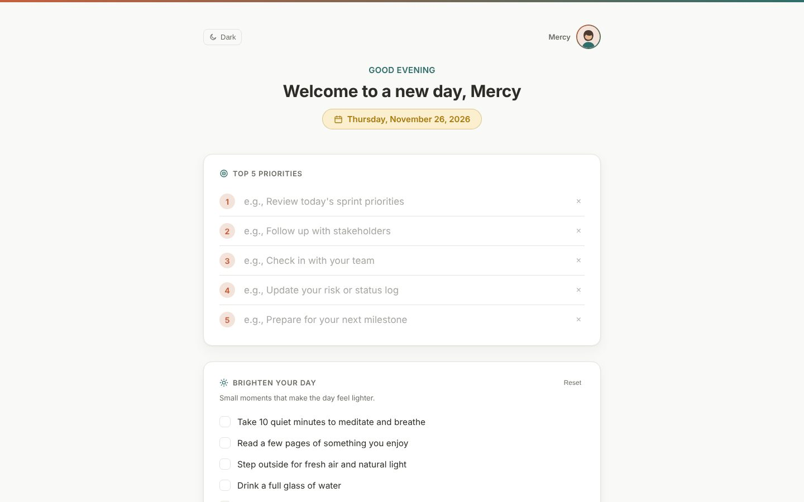

# Morning Dashboard

A single page I open every morning to start the day with a plan instead of reacting to whatever arrives first: my top five priorities, a few small habits, and one-click links to email, sheets and chat.

## Features

- **Top 5 priorities** — type them in once; they stay put between visits
- **Brighten your day** — a short checklist of small habits, resettable each morning
- **Quick links** to the tools the day starts in
- Time-aware greeting and today's date
- Light and dark mode

Everything is saved in the browser (`localStorage`). There is no account, server or tracking.

## Run it

It is one HTML file. Open `index.html` in a browser, or publish it with GitHub Pages (Settings → Pages → deploy from the `main` branch).

## Background

The brief behind the design — who it is for, the problem, the style and the writing rules — is in [PROJECT_BACKGROUND.md](PROJECT_BACKGROUND.md).
